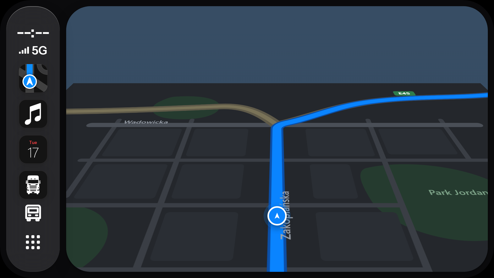
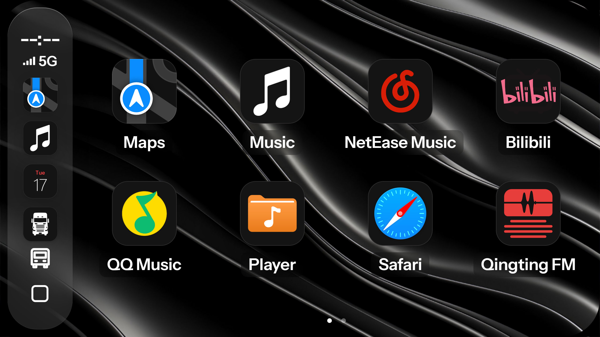
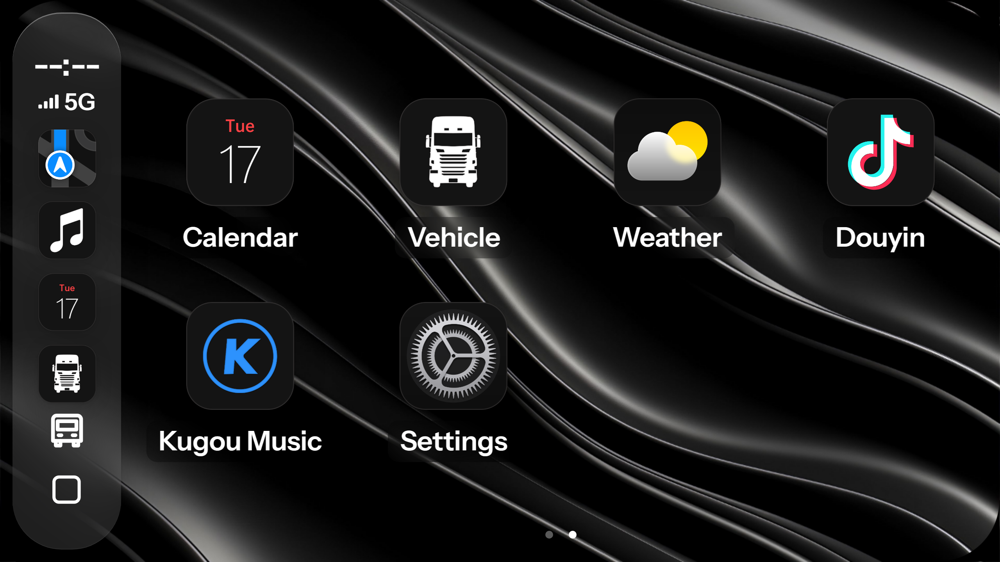
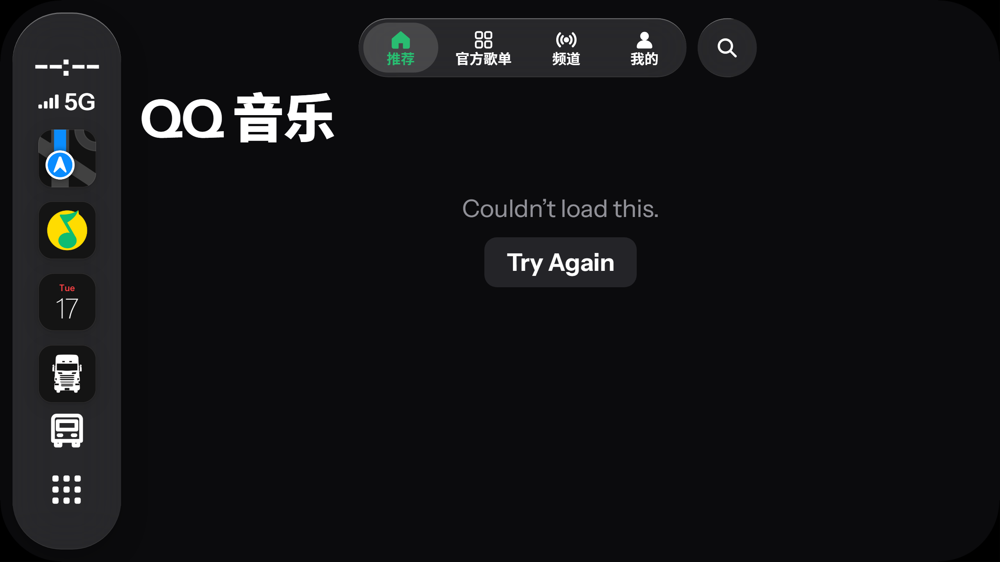

<h1 align="center">WestPlay CN Vision</h1>

  <b>为《欧洲卡车模拟 2》与《美国卡车模拟》打造的车机屏。</b> 
  你的地图、你的音乐、还有开车时刷的 B 站 —— 全在你卡车自己的中控屏上。

  
  
  
  
  

  <a href="#特点">特点</a> ·
  <a href="#和原版有什么不同">和原版有什么不同</a> ·
  <a href="#安装">安装</a> ·
  <a href="#更新">更新</a> ·
  <a href="#致谢">致谢</a>

 

<picture>
  <source media="(prefers-color-scheme: dark)" srcset="docs/images-cn/home-dark.png">
  <source media="(prefers-color-scheme: light)" srcset="docs/images-cn/home-light.png">
  
</picture>

WestPlay CN Vision 在原版 WestPlay 的基础上，为中文玩家重做了一遍：界面汉化，用**国内能用的服务**
替换掉 Spotify、YouTube 和 YouTube Music，并把它们接进了主屏的媒体控件 —— 一边开车一边切歌、看歌词。

## 特点

<table>
  <tr>
    <td width="50%" valign="top">
      <picture>
        <source media="(prefers-color-scheme: dark)" srcset="docs/images-cn/maps-dark.png">
        <source media="(prefers-color-scheme: light)" srcset="docs/images-cn/maps-light.png">
        
      </picture>
      <h3>来自你自己游戏的地图</h3>
      用你的游戏地图（含 ProMods 等地图 Mod）实时绘制，带你的路线、逐向导航，
      以及搜索后直接加进游戏 GPS 的途经点。
    </td>
    <td width="50%" valign="top">
      <picture>
        <source media="(prefers-color-scheme: dark)" srcset="docs/images-cn/dashboard-dark.png">
        <source media="(prefers-color-scheme: light)" srcset="docs/images-cn/dashboard-light.png">
        
      </picture>
      <h3>为驾驶而生的仪表盘</h3>
      地图与正在播放的音乐并排，车速、限速标志、休息倒计时、天气，
      一个界面里看得全。
    </td>
  </tr>
  <tr>
    <td width="50%" valign="top">
      <picture>
        <source media="(prefers-color-scheme: dark)" srcset="docs/images-cn/home-apps-dark.png">
        <source media="(prefers-color-scheme: light)" srcset="docs/images-cn/home-apps-light.png">
        
      </picture>
      <h3>一大堆常驻应用</h3>
      日历（图标显示当天日期）、车辆状态、天气、抖音、酷狗音乐、设置…
      全部用玩家自制的 Apple 风格图标，深色浅色各一套。
    </td>
    <td width="50%" valign="top">
      <picture>
        <source media="(prefers-color-scheme: dark)" srcset="docs/images-cn/qq-music-dark.png">
        <source media="(prefers-color-scheme: light)" srcset="docs/images-cn/qq-music-light.png">
        
      </picture>
      <h3>QQ 音乐，完整版</h3>
      自绘界面 + 本地中间层取数，随安装包附带、自动启停。登录状态、个性化推荐、
      官方榜单、雷达推荐、音量记忆 —— 重启不用重新登录。
    </td>
  </tr>
</table>

## 和原版有什么不同

这一版是基于原版 WestPlay 2.4.0（GPL-3.0）由 **DeepSeek Harness** 参与，经过大量修改得到的。

### 汉化

- 主屏、设置、伴侣程序的界面全部中文化
- 游戏内 UI 文案、提示、引导流程汉化

### 国内服务替换

| 原版 | 本版 |
|---|---|
| Spotify | **网易云音乐**（网页版）|
| YouTube | **哔哩哔哩**（开车刷 B 站）|
| YouTube Music | **QQ 音乐**（自研播放器 + 本地中间层）|

另外还接了抖音、酷狗音乐、蜻蜓 FM。

### 媒体控件接入

网易云和 QQ 音乐都接进了插件主屏自带的媒体控件：

- 切歌、暂停 / 播放
- 显示当前播放的歌曲、歌手、封面
- **显示正在播放的歌词**

## 安装

1. 到 [Releases](https://github.com/LucianLuu/WestPlay-CN-Vision/releases/latest) 下载最新的安装包
2. 运行安装，按提示完成
3. 启动游戏，WestPlay 会自动连接

需要 Windows 10 / 11（64 位），游戏版本 1.62。

### QQ 音乐

QQ 音乐用的是本地中间层（随安装包附带，约 70 MB 运行时），启动 WestPlay 时会自动拉起，
关闭时自动退出，不需要你手动操作。

第一次使用时在 QQ 音乐界面的「我的」里登录，之后会一直保持。

## 更新

更新**从本仓库的 Releases 获取**，使用 WestPlay CN Vision 自己的签名密钥校验：

- 每次启动 30 秒后检查一次，之后每 6 小时一次
- 也可以在伴侣程序的「关于」页手动检查
- 更新包下载后会**验签**，签名不对不会安装
- 安装时游戏需要关闭

发版流程见 [RELEASE-CN-VISION.md](RELEASE-CN-VISION.md)。

## 隐私

和原版一样：你的地图、你的音乐、你的路线都在你自己的电脑上。WestPlay 不收集遥测，
不把任何数据发给第三方 —— 除了你主动使用的在线服务（网易云、B 站、QQ 音乐、天气），
它们各自按自己的隐私政策处理你登录后的数据。

QQ 音乐的登录凭证存在本地中间层的账号池里，不经过 WestPlay 本身，也不进渲染页面。

## 致谢

- **[enes-less/WestPlay](https://github.com/enes-less/WestPlay)** —— 原版，一切的起点（GPL-3.0）
- **L-1124/QQMusicApi** —— QQ 音乐接口封装与中间层（GPL-3.0）
- 提供 Apple 风格图标包的玩家
- 所有帮忙测试、报 bug 的玩家

## 许可协议

[GPL-3.0-or-later](LICENSE)，与原版一致。

本项目是原版 WestPlay 的衍生作品：所有原版的代码仍是原作者 enes-less 的版权，
本版在其基础上的修改同样以 GPL-3.0 发布。第三方组件许可见
[THIRD_PARTY_LICENSES.md](THIRD_PARTY_LICENSES.md)。
